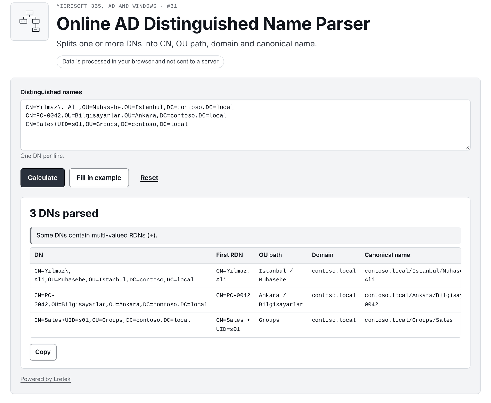

# AD Distinguished Name Parser

Split an Active Directory distinguishedName into RDNs: CN, OU path, domain and canonical name. Escaped commas and multi-valued RDNs are supported.

## Try it live

- [Türkçe](https://sistem.eretek.com/araclar/ad-dn-ayristirici)
- [English](https://sistem.eretek.com/en/tools/ad-dn-parser)
- [Deutsch](https://sistem.eretek.com/de/werkzeuge/ad-dn-parser)



## What it does

Splits one or more DNs into CN, OU path, domain and canonical name.

Splitting a DN at commas fails for objects with a comma in their name (`CN=Yılmaz\, Ali`). The tool applies the RFC 4514 escaping rules, keeps multi-valued RDNs (`+`) and returns the OU path in readable left-to-right order.

## Where it helps

Use the OU path for moves (Move-ADObject) or GPO link checks, and the canonical name to compare with Active Directory Users and Computers.

## How to use it

1. Paste one DN per line and press Calculate.

### Fields

| Field | Description |
|---|---|
| Distinguished names | One DN per line. |

## Example input

Press **Fill in example** in the tool to load this input.

**Distinguished names**

```text
CN=Yılmaz\, Ali,OU=Muhasebe,OU=Istanbul,DC=contoso,DC=local
CN=PC-0042,OU=Bilgisayarlar,OU=Ankara,DC=contoso,DC=local
CN=Sales+UID=s01,OU=Groups,DC=contoso,DC=local
```

**Expected result:** On the first line the CN is 'Yılmaz, Ali', OU path Istanbul / Muhasebe, domain contoso.local, canonical name contoso.local/Istanbul/Muhasebe/Yılmaz, Ali.

## Method and assumptions

Characters are read left to right; the character after a backslash (or two hex digits such as `\2C`) belongs to the value. An unescaped `,` or `;` separates RDNs, `+` separates attributes of a multi-valued RDN.

DC components form the domain, OU components in reverse order the OU path. Canonical name: `domain/OU1/OU2/CN`.

## Limits and common mistakes

- It does not connect to the directory or check whether the DN exists.
- Hex BER-encoded values (`#04…`) are not decoded.

## Run it locally

The tool is plain HTML, CSS and JavaScript with no build step and no dependencies.

```bash
git clone https://github.com/eretek/ad-dn-parser.git
cd ad-dn-parser
node scripts/serve.js        # or: python3 -m http.server 8080
```

Open <http://127.0.0.1:8080/>. Add `?lang=tr` or `?lang=de` for Turkish or German; without it the page follows the browser language and falls back to English. You can also open `index.html` directly from disk.

Run the tests (Node.js 18 or later):

```bash
node test/run.js    # or: npm test
```

The tests run the tool's own fixtures and the worked examples in all three languages without a browser.

## How it works

All processing happens in your browser. The tool makes no network requests, uses no cookies or browser storage, and does not upload files you select.

No server-side component is needed. The version on the Eretek website renders the same page through a private WordPress plugin; that plugin only produces the page markup and is not part of this repository.

| Path | Purpose |
|---|---|
| `index.html` | Page shell |
| `src/app.js` | Builds the page in Turkish, English or German from `src/data.js` |
| `src/data.js` | Field definitions, examples and all texts in three languages |
| `src/core.js` | Shared runtime: validation, number formats, result rendering, CSV/ICS export |
| `src/tool.js` | The calculation or analysis for this tool |
| `docs/screenshot.png` | Screenshot used in this README |
| `src/tools.css`, `src/page.css` | Styles |
| `test/run.js`, `test/cases.json` | Headless tests |

## License and attribution

This tool is released under the [Eretek Website Attribution License](LICENSE). You may use, modify and redistribute it, including commercially. If you make it available on a website or web application, show a visible, clickable credit linking to https://eretek.com/ on every page where the tool is available, for example:

```html
<a href="https://eretek.com/">Powered by Eretek</a>
```

You may add `rel="nofollow"` to the link. Keep the copyright notice and license text in copies and redistributions.
